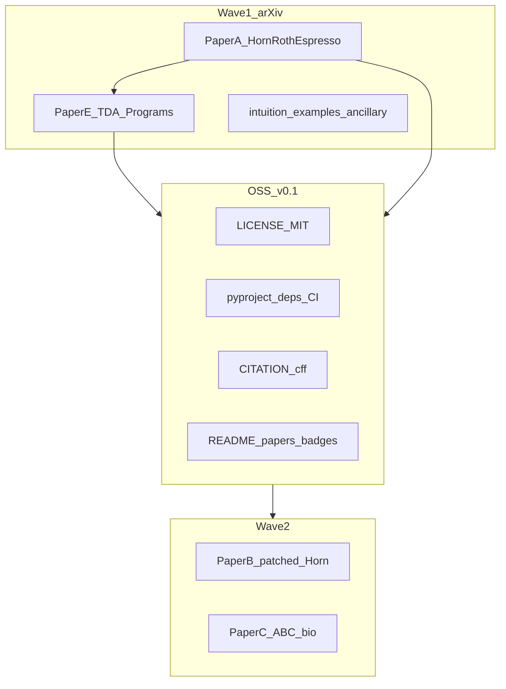

# ArXiv Tranche + TopoSpine OSS Release (Sherlock Plan)

## Sherlock protocol (Steps 1–5)

### Step 1 — Reflect (what could block arXiv + OSS)

1. **Claim / paper inconsistency**: Paper B still asserts covering vacuity on \(8^3\)/2007 ([`papers/B-certified-synthesis/main.tex`](papers/B-certified-synthesis/main.tex) ~L65); Paper E / C56 contradict that.
2. **Wrong paper mix for first arXiv**: Shipping all of A–E at once dilutes strength; D’s recall/topology claims are weak (C20/C29 downgraded).
3. **Label leakage**: Camera-ready still mixes PROVED / TESTED / DISPROVED; informal TU (C10) must not read as a theorem.
4. **OSS packaging gaps**: No `LICENSE`; [`python/pyproject.toml`](python/pyproject.toml) has empty runtime deps; [`README.md`](README.md) stuck at Loop 5 / no Horn/E.
5. **Repo / identity**: Remote is nested under `ajjax` (`ajjax/topospine/cursor/paper-a-mvp`), not a clean public `topospine` product repo.
6. **Third-party Espresso**: Berkeley sources under [`third_party/espresso`](third_party/espresso) need license notice + build docs; binary must not be the only path.
7. **Reproducibility gate**: arXiv + OSS both need one frozen “release commit” that passes pytest / lake / tutorials / tectonic for the submitted PDFs.

### Step 2 — Distill (most likely blockers)

| Rank | Blocker | Why |
|------|---------|-----|
| 1 | B↔E contradiction on covering vacuity | Any joint citation or “suite” release fails peer reading |
| 2 | No LICENSE + thin packaging | Blocks GitHub public release and many orgs’ reuse |
| 3 | Over-broad first arXiv set | Dilutes A/E’s Lean+program story; D not ready |

### Step 3 — Investigate (current evidence)

| Artifact | State |
|----------|--------|
| Paper A | ~482 lines; H1–H4 + Espresso-Horn; Lean C45–C55; intuition companion | arXiv-primary |
| Paper E | ~142 lines; C56–C58; medical non-vacuous Horn | arXiv companion to A |
| Paper B | Short; **outdated vacuity claim**; Lean/pass manager story | Must patch before cite-as-current |
| Paper C | Bio/ABC/DC spine; empirical | Second wave |
| Paper D | Embeddings/Laplacian; weak topology claims | Defer arXiv |
| OSS | `pip install -e` works in spirit; no LICENSE; README stale; no CI for public |

### Step 4 — Analysis (recommended product shape)

**Default choices (locked):**
- First arXiv submissions: **A + E** (same week; E cites A; A cites E as “program companion”). Ancillary: `intuition_examples.pdf` with A.
- Defer D. Patch B before any B arXiv or before OSS README claims “covering modes.”
- Public repo name: **`topospine`** under `ajjcoppola` (new GitHub repo; push release tag from current tree). License: **MIT**.
- Version: **`0.1.0`** tagged `v0.1.0-arxiv-ae` matching the A+E PDF freeze.

### Step 5 — Suggestions (diagnostics before submit)

- One script `scripts/release_gate.sh`: pytest, lake build, tutorials 01–06, tectonic A/E (+ B after patch).
- Grep gate: fail if Paper B still contains “vacuous” without “superseded by Paper E.”
- Claim-ledger freeze table in `docs/arxiv-ae-freeze.md` listing C45–C58 labels as they appear in PDFs.

---

## Implementation plan (after approval)

### Phase 0 — Consistency surgery (1–2 days)

- Patch [`papers/B-certified-synthesis/main.tex`](papers/B-certified-synthesis/main.tex): replace vacuity paragraph with “single-face covering was vacuous; Horn covering (Paper E / C56) is non-vacuous,” point to medical table.
- Update [`docs/camera-ready-checklist.md`](docs/camera-ready-checklist.md) C21 row to “historical negative; superseded for Horn.”
- Align [`README.md`](README.md) status to Papers A–E + Horn covering.

### Phase 1 — ArXiv Wave 1: Papers A + E

**Paper A polish**
- Authors/affiliations, abstract keywords (logic minimization, cubical complexes, Horn retraction).
- Ensure every non-PROVED claim is labelled; TU stays PROPOSED.
- Freeze benches: espresso_horn, horn_chain, layer0 tables committed.
- Upload: `main.pdf` + ancillary `intuition_examples.pdf` + optional talk PDF.

**Paper E polish**
- Cross-cite arXiv IDs once A is up (or simultaneous “submitted” footnotes).
- Keep Conjecture E1 clearly non-claim.
- Tables: medical, spine-horn, classic-espresso.

**Metadata**
- Categories: primary `cs.LO` or `math.CO`; secondary `cs.CG` / `cs.SC` as fits.
- `docs/arxiv-ae-freeze.md` + Sherlock log `SHERLOCK_ARXIV_OSS_*.md` + session row.

### Phase 2 — OSS v0.1 tied to A+E

- Add root `LICENSE` (MIT) + `NOTICE` for Berkeley Espresso third_party.
- Flesh [`python/pyproject.toml`](python/pyproject.toml): runtime deps (`numpy`, `scipy` optional extras for HiGHS/ABC/gudhi), `project.urls` → GitHub + arXiv A/E.
- Add `CITATION.cff` with paper titles and placeholder arXiv IDs (fill after accept).
- Public README: install, quickstart, “Papers” section with claim-ledger honesty, badges for CI.
- GitHub Actions: `pytest` + `lake build` on push; optional tectonic on papers if TeX image available.
- Create/push `github.com/ajjcoppola/topospine` (or Cursor Origin equivalent); tag `v0.1.0-arxiv-ae`.
- Do **not** claim D/C as published until Wave 2.

### Phase 3 — Wave 2 (after Wave 1 IDs exist)

- Paper B arXiv (patched architecture paper) citing A+E.
- Paper C arXiv (empirical ABC/bio) with EMPIRICAL-SYNTHETIC labels hard.
- Optional: merge thin E content into A as “§Programs” if arXiv prefers one long paper — only if A+E dual-submit is rejected for overlap; default remains two papers.

### Out of scope for this plan

- Paper D arXiv.
- Proving Conjecture E1 / TU with Bala.
- Million-scale Espresso solver.
- Migrating private outreach from `math-tda`.

### Success criteria

- A and E on arXiv with consistent claims.
- Public `topospine` repo: MIT, installable, CI green, CITATION → arXiv.
- B no longer contradicts E.
- Release gate script green on the tagged commit.
