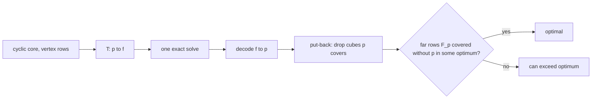

# Paper A redo: the free-face collapse as a local transform

## What the Sherlock pass found
Scratch harness: `/tmp/sherlock_grid/` (grids of unit squares, each filled, hollow, or absent; columns are top cells; unit cost).
- **Row model is the missing piece.** With rows = all proper faces, a free face is a row only its square covers. That square is essential, and 0 of 4,149 3x3 cyclic cores keep a collapsible square. With rows = vertices (the logic-minimization problem), collapsible squares survive into 6,126 cores, and the 2007 rule (replace `p` by its free face `f`) fails on 1,206 of them.
- **Put-back bug in code.** `restore()` in [python/topospine/cover/minimize.py](python/topospine/cover/minimize.py) swaps `f` back to `p` and never removes columns now covered by `p`. The paper's `Reduced` step is not implemented. Fixing it rescues only 45 of 1,251 raw failures on 3x3, so the gap is geometric, not bookkeeping.
- **Failures follow the far side of `p`.** They happen when vertices of `p` not on `f` still need covering and no optimal cover reaches them without `p`.
- **Earlier witnesses were wrong for this question.** `P6`, the 3-edge path, and the cyclic-core edge pictures contain essential edges, so they are not cyclic cores. They come out of the paper and talk as collapse evidence.

## The theorem to prove (vertex rows)
Setting: residual rows `R` of a cyclic core, `p` a filled square with free face `f`, far rows `F_p = (V(p) ∩ R) \ V(f)`.
- **Transform `T`:** columns `P' = P - {p} + {f}`. Decode `δ(S')` swaps `f` to `p`, then put-back removes every chosen cube the rest of the cover now covers (minimum sub-cover).
- **Lemma A:** `opt(P') <= C_out` (unconditional).
- **Lemma B:** decode plus put-back is feasible and never raises cost.
- **Theorem (interface characterization):** `opt(P') = opt(P)` if and only if some optimal cover of `P` either excludes `p`, or covers `F_p` without `p`. Proof is two directions, about half a page. This replaces the transport hypothesis (H) with a geometric statement about the far side.
- **Proposition (row-model dichotomy):** under face rows, a free face forces its square in (essential). That is the correct reading of "free faces generalize essential primes".

## Sufficient-condition search (the /loop)
Dynamic local loop (monitored shell wake). One round: run the harness, test the next candidate, record, refine. Stop when a candidate fires on at least 5% of (core, p, f) cases with zero failures, or after 5 rounds. Then report.
- Data: 3x3 exhaustive; 3x4 exhaustive (531,441 configs) after moving the exact solver to bitmasks; 4x4 sampled.
- Candidates in order:
  1. `F_p` empty. Sufficient but trivial: `p` and `f` cover the same rows. Reported separately.
  2. `|F_p| = 1` with `|V(f) ∩ R| = 1`. 0 failures on 3x3; needs bigger grids.
  3. Every far row lies in a column that dominates `p` on the far side.
  4. ABC-style window check: radius-1, then radius-2 neighbourhood of `p`. For every external coverage pattern on the window boundary, the local optimum with `f` equals the local optimum with `p`. This is sufficient by construction and checkable; rounds widen the window.
  5. Whatever the round-1 to round-4 feature tables suggest.
- Each round writes `benchmarks/results/grid_collapse_round{k}.json` and a line in the Sherlock log.

## Files
- New [python/topospine/cover/grid2d.py](python/topospine/cover/grid2d.py): grid complexes, vertex-row tables, far rows, window profile check.
- New [benchmarks/run_grid_collapse_audit.py](benchmarks/run_grid_collapse_audit.py): audit table TeX and grid figures (filled squares shaded, hollow squares as edges, `p`, `f`, far side highlighted).
- [python/topospine/cover/minimize.py](python/topospine/cover/minimize.py): `restore` gets put-back with minimum sub-cover (greedy past 16 columns, recorded in stats). Re-run the Boolean n=5 audits.
- [python/topospine/cover/out_complex.py](python/topospine/cover/out_complex.py): docstring and tests mark `P6` and path witnesses as non-core.
- New tests: `tests/test_grid_collapse.py` covering:
  - the row-model dichotomy on 3x3;
  - the smallest 2x3 counterexample;
  - the theorem's "if and only if" checked on every 3x3 case;
  - the put-back fix.
- New Lean `lean/TopoSpine/LocalTransform.lean`: Lemma A, Lemma B, and the characterization on abstract finite covers; `decide` check of the smallest 2x3 grid counterexample (vertex bitmasks). `OutComplex.lean` keeps its lemmas; the `P6` theorem is relabelled as a non-core example.
- [papers/A-cyclic-core/main.tex](papers/A-cyclic-core/main.tex):
  - rewrite §3 around the row model, transform, put-back, the theorem, and the dichotomy;
  - TikZ grid figures replace the 1D examples;
  - the Out_complex subsection is trimmed to the true lemmas plus the cyclic-core result;
  - the Boolean n=5 counts are kept as Boolean evidence.
- [papers/A-cyclic-core/talk/main.tex](papers/A-cyclic-core/talk/main.tex): new arc:
  1. filled/hollow grid examples;
  2. the two row models;
  3. the transform with the put-back picture;
  4. the far side and the theorem;
  5. the smallest counterexample;
  6. loop results;
  7. shotgun, kept.
- [docs/claim-ledger.md](docs/claim-ledger.md), [docs/camera-ready-checklist.md](docs/camera-ready-checklist.md): C2 restated; C36 retracted as a core witness; new rows for the dichotomy, the theorem, the put-back fix, and the loop outcome. Tutorial 05 updated.
- Sherlock log `docs/sherlock/SHERLOCK_PAPER_A_REDO_<date>.md`, session log row, history mirror, plan copies in both plans folders.

## Done when
- The theorem's "if and only if" holds on every 3x3 case (exhaustive) and on 3x4. Lean builds with no `sorry`. pytest and Tutorials 01–06 pass.
- Paper A and the talk compile with grid figures and no 1D or path witnesses offered as cyclic cores.
- The loop reports a passing condition or 5 rounds of recorded misses. Either is written up in the paper as found.
