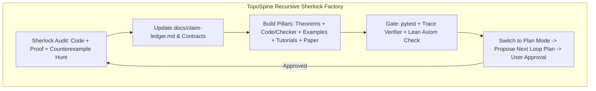
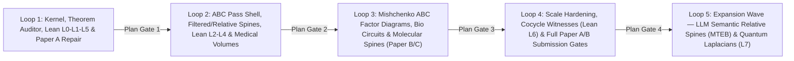

# TopoSpine Scientific Code & Paper Factory — Master Architecture & Loop 1 Plan

## 1. Charter & Recursive Sherlock Factory Protocol

**Charter:** `/Users/ajjc/proj/TopoSpine` is the unified monorepo for certified, optimized representations of finite cubical/simplicial complexes, filtrations, relative pairs, and logic/circuit networks—connecting exact Boolean covering and Alan Mishchenko ABC-style synthesis with scalable homological data structures and biomedical, molecular, semantic, and quantum applications.

**Recursive Self-Improvement Protocol (Approval-Gated):**
- Each iteration (`Loop k`) produces synchronized outputs across all five factory pillars: **Theorems**, **Programs & Checkers**, **Examples & Counterexample Zoo**, **Tutorials**, and **Papers**.
- At the end of `Loop k`, we execute a **Sherlock Mode Post-Audit**:
  - Reflect on discrepancies surfaced by exhaustive auditors, Lean proof obligations, and benchmark profilers.
  - Record verified statuses (`established`, `narrowed`, `conjectured`, `disproved`, `tested`) in `docs/claim-ledger.md` and `docs/sherlock/SHERLOCK_LOOP{k}.md` (plus `~/proj/modes/sherlock-mode/SESSION_LOG.md`).
  - Switch back to **Plan Mode** (`SwitchMode` to `plan`) and present the refined `Loop k+1` plan via `CreatePlan`, **stopping for explicit user approval** before any `Loop k+1` implementation begins.

---

## 2. Monorepo Layout (`/Users/ajjc/proj/TopoSpine`)

- `archive/` — Immutable historical provenance migrated read-only from `/Users/ajjc/proj/math-tda/CyclicCore-2026` (2006 SAT draft, 2007 Evergreen TR, 2022 SIAM PNW slides); private correspondence stays in `/Users/ajjc/proj/math-tda/outreach/`.
- `docs/`
  - `charter.md` — Scope, authorship consent policy, and trust boundaries.
  - `mathematical-contracts.md` — Typed preservation contracts (`Coverage`, `CoverOptimality`, `ElementaryCollapse`, `ChainEquivalence`, `PersistentEquivalence`, `RelativeEquivalence`, `ApproximatePersistence`) and optimality qualifiers (`Irredundant`, `LocallyMinimal`, `ProvenMinimum`, `ObjectiveApproximation`, `TopologicalApproximation`).
  - `claim-ledger.md` — Every theorem/proposition mapped to exact hypotheses, Python check, counterexample test, Lean declaration, and paper section.
  - `sherlock/` — Loop-by-loop Sherlock audit logs.
- `python/topospine/` — Certificate-first Python package:
  - `core/` — `BooleanCube`, `GridCube`, `CubicalComplex`, `SimplicialComplex`, oriented & $\mathbb{F}_2$ boundary matrices, exact rank/Betti homology, relative pairs $(K, A)$, filtration grades.
  - `checkers/` — Small, deterministic, independent verifiers for collapse traces, chain contractions ($pi = \mathrm{id}$, $\mathrm{id} - ip = dh + hd$), tower/filtration map compatibility, and cover optimality witnesses.
  - `cover/` — Exhaustive tiny-instance oracle, deterministic classical B&B, repaired `collapse_branch` with explicit `encode`/`decode` witness emission, counterexample enumerator, exact TU/minor/bipartite/network-matrix auditor, and Boolean gene-network loader.
  - `synth/` — ABC-inspired pass manager (`read -> validate -> simplify -> inspect_core -> rewrite -> check_cert -> export`) for cubical, flag, and logic/factor complexes.
  - `spines/` — Repaired `SpineMin`, `SpineTower` (selected-spine refinement maps), discrete LS-category (`gcat`), and adapters for GUDHI, CubicalRipser/cripser, Espresso, and Berkeley ABC.
- `certificates/` — Versioned JSON/JSONL certificate schemas and golden trace fixtures.
- `lean/TopoSpine/` — Lean 4 formalization (`L0` cells/grades, `L1` trace checker soundness, `L2` cubical $d\circ d=0$, `L3` collapse chain contraction, `L4` filtered/relative compatibility, `L5` `transport_optimum` + concrete cover specialization, `L6` cocycle witness transport, `L7` interleaving).
- `examples/` — Runnable curated datasets, counterexample zoo, and domain mini-benchmarks.
- `tutorials/` — Progressive executable tutorials (`01` through `05`) pairing math intuition, code, certificates, and Lean links.
- `benchmarks/` — Reproducible runners measuring wall time, peak RSS, total search nodes, certificate size, and checker runtime.
- `applications/` — Domain pipelines (`logic/`, `medical/`, `abc_circuits/`, `molecular/`, `embeddings/`, `quantum/`).
- `papers/`
  - `A-cyclic-core/` — *Certified Cyclic-Core Transformations for Minimum Covering* (with Weiss acknowledgment and Bala TU/neutralization hook).
  - `B-certified-synthesis/` — *TopoSpine: Certificate-Carrying Synthesis of Filtered Cubical and Dual Complexes*.
  - `C-abc-bio-molecular/` — *Topological Spines and Factor-Graph Reductions for Biomedical Circuits and Molecular Conformations*.

---

## 3. Multi-Loop Master Roadmap (Loops 1–5)

- **Loop 1 (THIS PLAN — Immediate Execution upon Approval):** Bootstrap `/Users/ajjc/proj/TopoSpine`; repair all 6 defects uncovered in Sherlock Pass 0; run the exhaustive Collapse-Branch Theorem Auditor & Counterexample Enumerator to lock exact hypotheses for one-recursion optimality; formalize `transport_optimum` + `L0/L1/L5` in Lean 4; deliver `examples/zoo_cyclic_core.py` (including a minimal Boolean gene-regulatory cover example) and `tutorials/01_cyclic_core_and_certificates.md`; update `papers/A-cyclic-core/main.tex` to match verified claims.
- **Loop 2 (Requires Approval of Plan 2):** Build the ABC-like pass manager shell (`topospine.synth`), filtration-compatible & relative cubical collapses, Lean `L2–L3–L4` ($d^2=0$ + collapse chain contraction), repaired `SpineMin`/`SpineTower` with dual cubical/nerve/Stanley–Reisner structures, Tutorial 02 & 03, and **MedMNIST 3D / micro-CT voxel** benchmarks against GUDHI and CubicalRipser.
- **Loop 3 (Requires Approval of Plan 3):** Integrate **Alan Mishchenko Berkeley ABC** / AIG / factor-diagram rewriting and don't-care spine extraction on circuit & synthetic-biology / signaling-pathway repositories alongside **MD17/MD22 molecular conformation** relative spines; Tutorial 04; draft Paper B & Paper C cores.
- **Loop 4 (Requires Approval of Plan 4):** Simultaneous boundary shelling ("shotgun" collapse), cocycle/cup-length witness transport (`Lean L6`), full MCNC + biomedical circuit + 3D medical volume ablations, and Paper A / Paper B camera-ready verification gates.
- **Loop 5 (Requires Approval of Plan 5):** Expansion tracks — Topic-relative semantic spines on **MTEB** embeddings and reduced boundary/Hodge-Laplacian operators (`Lean L7`) with honest sparsity, nonzero spectral-gap, and total classical+quantum resource accounting.

---

## 4. Detailed Specification for Loop 1 (What Will Execute First)

### Pillar 1 — Repairs & Programs (`python/topospine/`)
- **Fix Defect 1 (`row_cubes=None` clone bug in [code/pyccc/pyccc/collapse.py](/Users/ajjc/proj/math-tda/code/pyccc/pyccc/collapse.py)):**
  - Separate planar/grid cubical complexes (`GridCube` in $\mathbb{Z}^d$, which genuinely models Fig. 1's 9-square planar complex $S$ in the 2007 paper) from Boolean hypercube implicants (`BooleanCube` in $\{0,1,*\}^n$).
  - Construct the **true derived graded covering table** $T_C$ from a cubical complex (explicitly keeping 0-cells/1-cells/face rows with typed `row_cubes` so free-face columns compute exact sub-incidence `rc.is_face_of(face)` rather than cloning `parent_col`).
- **Fix Defect 2 (Collapse-Branch Theorem Auditor & Counterexample Enumerator):**
  - Implement `topospine/cover/auditor.py`:
    1. Exact brute-force / MIP-free exhaustive minimum-cover oracle for small instances ($n \le 20$ columns).
    2. Deterministic standard B&B and certified collapse-branch sharing identical preprocessing and tie-breaking, recording **total nodes, dominance passes, table width, wall time, and recursive calls**.
    3. Enumerate small Boolean functions ($3 \le n \le 5$ vars) and abstract cubical complexes to test single-face vs all-free-faces collapse, automatically surfacing any instance where a codim-1 free face has vertices jointly covered by lower-intersection primes while $p$ covers a shared face, and locking the exact checkable hypothesis (`StronglyFreeRow` / `CoverAdmissibleFreeFace`) under which `encode(C_in)` has cost $\le \mathrm{cost}(C_{\mathrm{in}})$.
- **Fix Defect 3 (Exact Homology, Strong Collapse, and TU Auditors):**
  - Replace `_beta_d` in [code/pyccc/pyccc/topology.py](/Users/ajjc/proj/math-tda/code/pyccc/pyccc/topology.py) with exact $\mathbb{F}_2$ Gaussian elimination on boundary matrices $\partial_d$ for arbitrary dimension $d \ge 0$ (verifying $\partial_{d-1}\circ \partial_d = 0$ and $\beta_1(\Delta^2) = 0$).
  - Fix `is_collapsible` in [code/pyccc/pyccc/lscat.py](/Users/ajjc/proj/math-tda/code/pyccc/pyccc/lscat.py) to use weak closed-neighborhood inclusion $N[v] \subseteq N[u]$ ($u \ne v$) on flag complexes + elementary simplicial free-face collapses, removing the silent `feasible = all` masking fallback in [code/pyccc/pyccc/tower.py](/Users/ajjc/proj/math-tda/code/pyccc/pyccc/tower.py).
  - Fix `is_totally_unimodular` in [code/pyccc/pyccc/tu.py](/Users/ajjc/proj/math-tda/code/pyccc/pyccc/tu.py) to test full minors up to exact size (catching $C_5$ $5\times 5$ $\det = \pm 2$) plus Ghouila-Houri / LP-extreme-point integrality witness checks for larger cyclic cores.
- **Deterministic Certificate Checker (`topospine/checkers/`):**
  - Define JSON certificate schemas in `certificates/schema_v1.json` for `ElementaryCollapseTrace` and `CoverOptimalityWitness` (`encode`/`decode` check on concrete solution).

### Pillar 2 — Theorems & Lean 4 (`lean/TopoSpine/`)
- Initialize `lean/TopoSpine` and verify clean compilation with zero `sorry` on released theorems:
  - `L0` (`TopoSpine/Basic.lean`): Finite graded cell poset, `HasFreeFace`, `Subcomplex`.
  - `L1` (`TopoSpine/TraceChecker.lean`): Executable boolean free-face trace checker and soundness proof that accepted elementary collapse steps preserve Euler characteristic and declared subcomplex containment.
  - `L5` (`TopoSpine/OptimalityTransport.lean`): Checked `transport_optimum` theorem (`#print axioms` audited empty/standard) plus concrete `CoverInstance` specialization under the verified admissibility hypothesis from the Python Theorem Auditor.

### Pillar 3 — Examples & Biomedical Seed (`examples/`)
- `examples/zoo_cyclic_core.py`:
  - Reconstructed 2007 planar 9-square hexagon complex $S$ (`GridCube`) vs Boolean hypercube cyclic cores (`BooleanCube`), tiled disjoint unions $S^{\sqcup k}$, suspension spheres $X_3, X_4$ (with $X_4$ un-quarantined and solved with exact finite cost), Bing's house, dunce cap, $C_5$ non-TU odd-hole core, and any counterexample discovered by the auditor when the admissibility check is omitted.
- `examples/bio_boolean_gene_network.py`:
  - Exact minimum-cover / prime-implicant reduction of a small published Boolean cell-cycle / signaling truth-table regulator, demonstrating certified collapse-branch + biomarker panel minimality.

### Pillar 4 — Tutorial (`tutorials/`)
- `tutorials/01_cyclic_core_and_certificates.md` + runnable companion script `tutorials/run_tutorial_01.py`:
  - Step-by-step researcher & student walkthrough: building a cubical complex, generating the graded covering matrix, running the theorem auditor, inspecting a JSON collapse/cover certificate, seeing why naive free-face intuition needs the `encode`/`decode` transport contract, and checking the matching Lean 4 theorem.

### Pillar 5 — Paper A Repair (`papers/A-cyclic-core/`)
- Migrate Paper A from `/Users/ajjc/proj/math-tda/papers/paperA-duality/main.tex` (preserving Richard Weiss's approved Acknowledgment and Bala Krishnamoorthy's proposed co-author hook).
- Repair Theorem 3 (`thm:collapse`) and Example (`ex:cyccore`) so every hypothesis, weighted-cost condition, counterexample boundary, and benchmark metric (both recursive calls AND total B&B search nodes/runtime) matches `docs/claim-ledger.md` and compiles cleanly via `tectonic`.

### Loop 1 Completion & Recursive Stop Gate
- Run full `pytest`, independent certificate checker, Lean build + `#print axioms`, and `tectonic` build of Paper A.
- Write `docs/sherlock/SHERLOCK_LOOP1_2026-11-16.md` and log the session in `~/proj/modes/sherlock-mode/SESSION_LOG.md`.
- Switch back to **Plan Mode** and present the **Loop 2 Plan** (ABC synthesis pass shell + filtered/relative cubical spines + MedMNIST 3D / CubicalRipser benchmarks + Lean L2–L4) for approval.