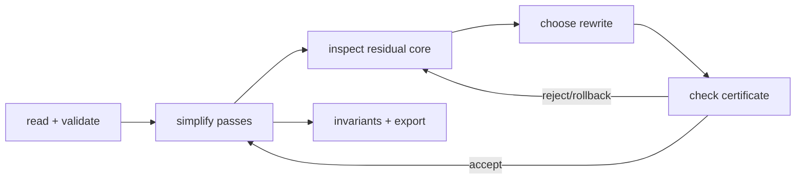

# TopoSpine Factory Loop 2 — Pass Shell, Filtered Spines & Medical Volumes

## Loop 1 gate (done)

Home: [`/Users/ajjc/proj/TopoSpine`](/Users/ajjc/proj/TopoSpine). Verified: 8 pytest green; Tutorial 01 OK; Lean `transport_optimum` axiom-free; Paper A PDF at [`papers/A-cyclic-core/main.pdf`](/Users/ajjc/proj/TopoSpine/papers/A-cyclic-core/main.pdf); Sherlock log [`docs/sherlock/SHERLOCK_LOOP1_2026-11-17.md`](/Users/ajjc/proj/TopoSpine/docs/sherlock/SHERLOCK_LOOP1_2026-11-17.md).

## Loop 2 objective

Make TopoSpine a **certificate-carrying rewrite engine** (not only a cover solver): typed preservation contracts on every pass, filtered/relative collapses with Lean chain-level soundness, homology-faithful spines/towers, and a first medical-volume win against established cubical PH tools.

## Workstreams

### 1. ABC-style pass manager (`python/topospine/synth/`)

- Implement `PassManager` IR: complex + optional filtration grades + designated relative subcomplex $A$ + rewrite log.
- Passes (each emits a JSON certificate checked by [`python/topospine/checkers/`](/Users/ajjc/proj/TopoSpine/python/topospine/checkers/)):
  - `ElementaryCubicalCollapsePass` (reuse Loop 1 free-face machinery)
  - `FiltrationCompatibleCollapsePass` (refuse moves that break grade inclusions)
  - `RelativeCollapsePass` (preserve designated $A$)
  - `FlagEdgeCollapseAdapterPass` (thin wrapper documenting GUDHI edge-collapse as baseline — do not reimplement from scratch)
  - `BoundedExactCorePass` (call Loop 1 `minimize_cover` / auditor on small residues)
- Checkpoint + rollback; cost-based selection among valid transforms.
- Extend [`certificates/schema_v1.json`](/Users/ajjc/proj/TopoSpine/certificates/schema_v1.json) with `PassTrace` / `FiltrationMapWitness`.

### 2. Lean L2–L4 (`lean/TopoSpine/`)

- **L2** `Boundary.lean`: cubical/simplicial $\partial$ over $\mathbb{F}_2$ or $\mathbb{Z}$, prove $d\circ d=0$ on finite examples matching Python `verify_d_squared_zero`.
- **L3** `CollapseContraction.lean`: elementary-collapse chain contraction ($pi=\mathrm{id}$, $\mathrm{id}-ip=dh+hd$) for a free-face pair.
- **L4** `FilteredRelative.lean`: filtration-grade and relative-pair compatibility hypotheses for accepted traces.
- Zero `sorry` on released theorems; `#print axioms` audited; update [`docs/claim-ledger.md`](/Users/ajjc/proj/TopoSpine/docs/claim-ledger.md).

### 3. Spines / towers repair (`python/topospine/spines/`)

- Port and repair SpineMin / SpineTower from math-tda `pyccc`:
  - Selected-spine refinement maps $U_{i+1}\to U_i$ (not all landmarks)
  - Remove silent `feasible = all` fallback; fail closed when collapsibility oracle returns empty
  - Dual views: cubical voxels, Vietoris–Rips/Čech nerve, Stanley–Reisner cochain stub
  - Certificates: coverage + nerve Betti (exact F₂) + declared interleaving constant (ApproximatePersistence contract — not ProvenMinimum)

### 4. Medical volume benchmarks (`applications/medical/`, `benchmarks/`)

- Pipeline: load small **MedMNIST 3D** (or synthetic voxel cubes if download blocked) → TopoSpine cubical filtration → pass manager reduce → export boundary / persistence via CubicalRipser/`cripser` or GUDHI cubical baseline.
- Report wall time, peak RSS, complex size before/after, persistence diagram bottleneck vs baseline on a fixed split.
- Gate: demonstrate advantage in **efficiency, verification, or witness recovery** on at least one volume family (not all four required).

### 5. Tutorials & Paper B draft

- [`tutorials/02_pass_manager_and_contracts.md`](/Users/ajjc/proj/TopoSpine/tutorials/02_pass_manager_and_contracts.md) + runner
- [`tutorials/03_spines_towers_medical.md`](/Users/ajjc/proj/TopoSpine/tutorials/03_spines_towers_medical.md) + runner
- Seed [`papers/B-certified-synthesis/main.tex`](/Users/ajjc/proj/TopoSpine/papers/B-certified-synthesis/main.tex): *TopoSpine: Certificate-Carrying Synthesis of Filtered Cubical and Dual Complexes* (architecture + Loop 2 benches; submission gate deferred to Loop 4)

### 6. Sherlock gate → Loop 3

- Update claim ledger; write `docs/sherlock/SHERLOCK_LOOP2_*.md`; append `~/proj/modes/sherlock-mode/SESSION_LOG.md`.
- Switch to Plan Mode and propose **Loop 3** (Mishchenko ABC factor diagrams + bio circuits + MD17/22 molecular spines) for approval.

## Defaults locked for this loop

- Medical stack: MedMNIST 3D primary; synthetic voxels as CI fallback if network/data unavailable.
- Persistence baseline: CubicalRipser/`cripser` preferred; GUDHI cubical as secondary comparator.
- No embeddings/quantum work in Loop 2 (deferred to Loop 5).
- Private outreach stays in `math-tda/outreach/` (not migrated).

## Completion criteria

- `pytest` green including new synth/spine/medical tests
- `lake build` with L2–L4 released theorems, zero `sorry`
- Tutorials 02–03 runners succeed
- At least one medical/synthetic volume bench table committed under `benchmarks/results/`
- Sherlock Loop 2 log written; Loop 3 plan presented for approval only