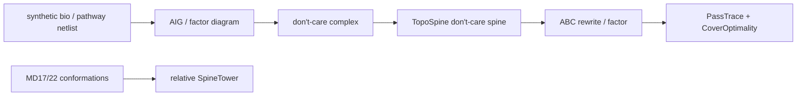

# TopoSpine Factory Loop 3 — ABC Factor Diagrams, Bio Circuits & Molecular Spines

## Loop 2 gate (done)

Home: [`/Users/ajjc/proj/TopoSpine`](/Users/ajjc/proj/TopoSpine). Verified: 15 pytest green; Tutorials 02–03 OK; Lean L2–L4 build; medical synth bench [`benchmarks/results/medical_loop2.json`](/Users/ajjc/proj/TopoSpine/benchmarks/results/medical_loop2.json) (81→49 cells); Paper B [`papers/B-certified-synthesis/main.pdf`](/Users/ajjc/proj/TopoSpine/papers/B-certified-synthesis/main.pdf); Sherlock [`docs/sherlock/SHERLOCK_LOOP2_2026-11-17.md`](/Users/ajjc/proj/TopoSpine/docs/sherlock/SHERLOCK_LOOP2_2026-11-17.md).

**Carry-forward from Loop 2 Sherlock:** elementary collapse can empty a covering IR (9→0 tops). Loop 3 adds an explicit **face-insertion / covering-mode** collapse for logic/ABC nets so homotopy reduction and cover semantics stay separate contracts.

## Loop 3 objective

Lift two-level spines into **multi-level logic synthesis** (Berkeley ABC / AIG / factor diagrams) and demonstrate **biomedical circuit** plus **molecular conformation** relative spines with certificate-carrying passes.

## Workstreams

### 1. Covering-mode collapse + ABC IR (`python/topospine/synth/`, `applications/abc_circuits/`)

- Add `CoveringAwareCollapsePass`: on free-face collapse, **insert free-face column/cell into the covering IR** (not only delete the top cell), matching Paper A expand semantics; keep existing elementary pass for pure simple-homotopy size reduction.
- Introduce thin **AIG / factor-diagram IR** (nodes = AND/NOT or factored cubes; edges = fanin) with export/import of a small BLIF/AIGER subset **or** a hand-built toy netlist format if linking Berkeley ABC binary is heavy — default: Python AIG subset + optional subprocess call to `abc` when present on `PATH`.
- Passes: `DontCareSpinePass` (SpineMin on observability/satisfiability don't-care cover), `FactorDiagramRewritePass` (local algebraic/Boolean factoring recorded as certificates), `AbcBaselineAdapterPass` (no-op or CLI wrapper like GUDHI adapter).

### 2. Bio circuits (`applications/abc_circuits/`, `examples/`)

- Synthetic-biology / signaling toy: multi-level Boolean gene network (extend Loop 1 `bio` toy) compiled to AIG IR; minimize with don't-care spines; report gate count before/after and CoverOptimality witness on residual.
- Pathway-scale stub: load a small published Boolean/rule network (or generate a 20–40 node cascade) as the Loop 3 bio bench row.

### 3. Molecular relative spines (`applications/molecular/`)

- Primary dataset: **MD17** (or MD22 if MD17 fetch fails) — if download blocked, use a **synthetic conformation cloud** (perturbed molecular graph embeddings in $\mathbb{R}^3$) as CI fallback (same pattern as MedMNIST Loop 2).
- Build relative SpineTower with designated subcomplex $A$ = functional group / binding-region landmarks; certificate `RelativeEquivalence` + `ApproximatePersistence`.
- Benchmark table: cover sizes, Betti per level, wall time vs coverage-only spine.

### 4. Tutorial 04 & Paper C draft

- [`tutorials/04_abc_bio_molecular.md`](/Users/ajjc/proj/TopoSpine/tutorials/04_abc_bio_molecular.md) + `run_tutorial_04.py`
- Seed [`papers/C-abc-bio-molecular/main.tex`](/Users/ajjc/proj/TopoSpine/papers/C-abc-bio-molecular/main.tex): *Topological Spines and Factor-Graph Reductions for Biomedical Circuits and Molecular Conformations*; compile draft PDF; include bio + molecular bench tables.

### 5. Lean / ledger

- Add Lean notes linking covering-mode collapse to L5 transport (no new heavy Mathlib dependency required).
- Update [`docs/claim-ledger.md`](/Users/ajjc/proj/TopoSpine/docs/claim-ledger.md) with C17–C20 (covering-mode collapse, ABC adapter, bio AIG reduction, molecular relative tower).

### 6. Sherlock gate → Loop 4

- Write `docs/sherlock/SHERLOCK_LOOP3_*.md`; append SESSION_LOG.
- Switch to Plan Mode; present **Loop 4** (shotgun shelling, cocycle/cup-length Lean L6, full ablations, Paper A/B camera-ready gates) for approval.

## Defaults locked

- ABC: Python AIG subset always; real `abc` CLI used when on `PATH`, otherwise adapter certificates only.
- Molecular: MD17 preferred; synthetic conformation cloud for CI if download fails.
- No MTEB embeddings / quantum Laplacians (Loop 5).
- Private outreach remains in `math-tda/outreach/`.

## Completion criteria

- pytest green including ABC/bio/molecular tests
- Tutorials 02–04 runners succeed; Tutorial 04 new
- Paper C draft PDF compiled
- Bio + molecular (or synthetic fallback) results under `benchmarks/results/`
- Covering-mode collapse does not silently empty covering IRs in regression tests
- Sherlock Loop 3 log written; Loop 4 plan presented for approval only