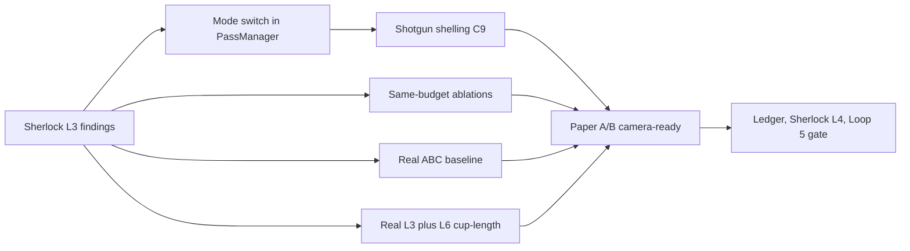

# TopoSpine Factory Loop 4 — Hardening, Shotgun Shelling, Lean L6, Camera-Ready

Home: `/Users/ajjc/proj/TopoSpine`. Input: [SHERLOCK_LOOP3_2026-11-17.md](/Users/ajjc/proj/TopoSpine/docs/sherlock/SHERLOCK_LOOP3_2026-11-17.md) suggestions and open ledger claim C9.

## Why this loop
Loop 3 produced results but also found problems. This loop fixes them before we build outward again.
- The Loop 1–2 "`lake build` succeeds" claim was false (fixed in Loop 3). Papers A/B and the ledger must not imply otherwise.
- Covering-mode collapse is not wired into `PassManager`. The default pass still deletes cells (medical synthetic 33→1, 2007 core 9→0).
- The relative tower's benefit has no same-budget baseline.
- Berkeley ABC has never been run.
- Lean L3 contraction laws are `True` placeholders.

## Workstreams

### 1. Mode-aware PassManager (covering vs homotopy)
- Add `mode: "homotopy" | "covering"` to `SynthesisState` / `PassManager.default(mode=...)` in [manager.py](/Users/ajjc/proj/TopoSpine/python/topospine/synth/manager.py).
- In covering mode, `CoveringAwareCollapsePass` replaces `ElementaryCubicalCollapsePass` and the size-reduction acceptance rule is replaced by a dimension/cost-reduction rule, so the manager does not stall.
- Extend `verify_pass_trace` so a covering-mode manager run is rejected if any pass is deletion-style.
- Rewire Tutorial 03 and the medical bench to report both modes honestly (cells before/after in homotopy mode; columns and dimension in covering mode).
- Regression tests: the 2007 core is never emptied in covering mode; the homotopy-mode behaviour is documented as intentional.

### 2. Ablations and baselines
- Relative tower: add a same-budget coverage-only baseline (match cover size) and an A-weighted greedy baseline in [relative_tower.py](/Users/ajjc/proj/TopoSpine/python/topospine/spines/relative_tower.py). Report A-radius, Betti agreement with a Rips reference when gudhi is available, and wall time. Either demonstrate a benefit or downgrade claim C20 in the ledger and Paper C.
- Bio and logic: add a literal-count objective as a second weight vector in `DontCareSpinePass`. Add ISCAS or EPFL small-circuit loading (`.pla` or `.blif` reader) with a size cap and a documented fallback.
- Real ABC baseline: try `pip`/`brew` install of `abc` or `yosys-abc`. If installable, run `AbcBaselineAdapterPass` on every bench circuit and add an ABC column to the bio table. If not installable, record the blocker and keep the no-op certificate.

### 3. Shotgun shelling (claim C9)
- Define the simultaneous multi-free-face collapse as a pass `ShotgunCollapsePass` plus a "shotgun" variant of the collapse-branch (several admissible faces applied at once, only if pairwise independent).
- Extend [auditor.py](/Users/ajjc/proj/TopoSpine/python/topospine/cover/auditor.py) to compare shotgun against exhaustive search and standard B&B on the enumerated n=3 and n=4 instances.
- Outcome is either evidence for or a counterexample against C9. Both go in the ledger. No claim is promoted without an exhaustive audit.

### 4. Lean L6 and a real L3
- Replace the `True` placeholders in `CollapseContraction.lean` with a concrete statement over F2 chain maps on small lists (contraction identities `p i = id` and `id - i p = d h + h d` for a single elementary collapse).
- New `Cocycle.lean`: coboundary squared is zero on the same schema, a cup product on 1-cochains of a simplicial complex, and the cup-length lower-bound lemma for Lusternik–Schnirelmann style covering bounds (statement and proof only where it stays free of Mathlib; otherwise a documented stub).
- Python side: `core/cohomology.py` for F2 cup products on a flag complex, with a test that cup-length bounds a cover size on the sphere/torus examples.
- Gate: bare `lake build` and `tests/test_lean_build.py` stay green. No `sorry`.

### 5. Paper A/B camera-ready gates
- Paper A: claims audit against the ledger (C2 narrowed, C3 open, C9 per section 3). Fix the Lean status text. Keep Weiss in Acknowledgments and Bala's TU section as proposed work.
- Paper B: correct "L0–L5 builds" language, add the mode-aware PassManager and covering mode, and cite the ablations.
- Paper C: update the tower and bio tables with the new baselines.
- Build all three PDFs with tectonic. Add a `docs/camera-ready-checklist.md` listing every unproven statement and its label.

### 6. Gate
- Update [claim-ledger.md](/Users/ajjc/proj/TopoSpine/docs/claim-ledger.md) (C9, C20, C16 and new rows for the mode switch, shotgun, L6).
- Write `docs/sherlock/SHERLOCK_LOOP4_*.md`, append `~/proj/modes/sherlock-mode/SESSION_LOG.md`, and mirror the log to `~/proj/history/topospine/sherlock-sessions/`.
- Add the Loop 4 plan copies under `~/.cursor/plans/` and `/Users/ajjc/proj/TopoSpine/.cursor/plans/`.
- Switch to Plan mode and present Loop 5 (LLM embeddings and quantum operators) for approval only.

## Completion criteria
- pytest green, including mode-switch, shotgun-audit, cohomology and Lean build tests.
- Tutorials 01–05 runners succeed (Tutorial 05 covers covering mode, shotgun and cup-length).
- Papers A, B, C compile. The camera-ready checklist has no unlabeled claim.
- Bench artifacts under `benchmarks/results/` regenerate with the new baselines.
- No silent emptying of a covering IR in covering mode. Sherlock Loop 4 log written. Loop 5 presented for approval only.

## Defaults and risks
- ABC may not be installable in the sandbox. The plan degrades to a recorded blocker, not a claim.
- Shotgun shelling may yield a counterexample. That is a valid outcome and is recorded as such.
- Lean cup-length without Mathlib may be restricted to a schema-level statement. The ledger will say so.
- No MTEB, quantum, or real MD17 downloads (the MD17 loader stays env-var driven). Private outreach stays in `math-tda/outreach/`.
